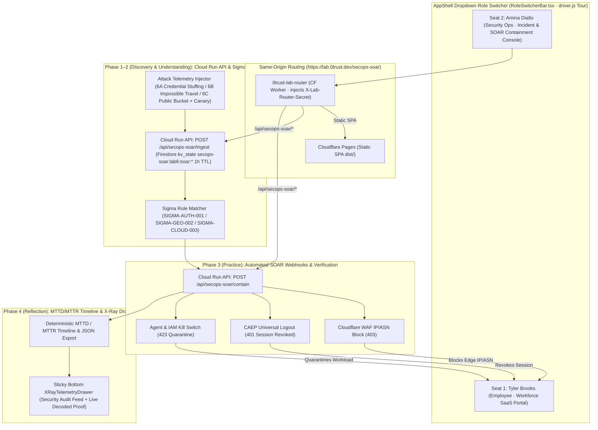

# Lab 6 Architecture: Live SecOps Detection & Automated SOAR (`/secops-soar`)

> **Zoom Level:** 2.5 (Lab Assembly + Infrastructure Mapping)  
> **Parent Overview:** [`0trust.dev/docs/ARCHITECTURE.md`](https://github.com/c2pig/0trust.dev/blob/main/docs/ARCHITECTURE.md)  
> **Experience Archetype:** Role-Specific AppShell (`Employee` ↔ `Security Ops`) with `driver.js` Orientation Overlay  
> **Hosting Split:** Static SPA (`dist/`) on **Cloudflare Pages** + API (`/api/secops-soar/*`) on **GCP Cloud Run** (`0trust-lab-secops-soar`, `min_instance_count = 0`) fronted by `0trust-lab-router`  
> **State Backend:** **Firestore Native** (`kv_state` collection, doc ID `secops-soar:<encodeURIComponent(key)>`, `lab6:soar:` prefix, `1h` TTL with synchronous `expireAt` enforcement; `MemoryKvAdapter` local fallback)  
> **Architecture SVG:** [`docs/diagrams/secops_soar_architecture.svg`](diagrams/secops_soar_architecture.svg)

---

## 1. End-to-End 2-Seat SecOps & SOAR Architecture

---

## 2. Distributed Repo & Infrastructure Ownership

| Lab Phase & Seat | Plain-English Purpose | Owning Application Repo | Provisioning Infrastructure |
| :--- | :--- | :--- | :--- |
| **Static SPA Delivery** | Serve React SPA (`dist/`) on `https://lab.0trust.dev/secops-soar` (local Vite port `5181`) | [`0trust-lab-secops-soar`](https://github.com/c2pig/0trust-lab-secops-soar) (`src/`, `vite.config.ts`) | `managed-infrastructure/modules/cloudflare-pages-lab` (`enable_custom_domain = false`, behind `0trust-lab-router`) |
| **Phase 1–2 (Discovery & Understanding · Seat 2 SOC)**: Telemetry & Sigma Matcher | Inject Credential Stuffing (`6A`), Impossible Travel (`6B`), or Public Bucket + Canary (`6C`) and match Sigma rules | [`0trust-lab-secops-soar`](https://github.com/c2pig/0trust-lab-secops-soar) (`server/app.ts` → synced `server/runtime.ts`, `functions/api/secops-soar/ingest.ts`, canonical `Dockerfile`) | `managed-infrastructure/modules/cloud-run-lab` (`0trust-lab-secops-soar`, `min_instance_count = 0`, WIF OIDC deploy) |
| **Workforce SaaS Portal & SOAR Containment (`Employee` ↔ `Security Ops`)** | Execute `WAF_BLOCK_ASN`, `CAEP_UNIVERSAL_LOGOUT`, or `AGENT_KILL_SWITCH` and verify target seat revocation (`401`/`403`/`423`) | [`0trust-lab-secops-soar`](https://github.com/c2pig/0trust-lab-secops-soar) (`src/pages/SecopsSoarPage.tsx`, `functions/api/secops-soar/contain.ts`, `server/kvAdapter.ts`) | **Firestore Native** (`kv_state` collection, `secops-soar:lab6%3Asoar%3A<sessionId>`, `1h TTL` + synchronous `expireAt` check) |
| **Telemetry & Sticky X-Ray Drawer** | Compare Manual vs. Auto-Remediate MTTR, export post-incident JSON, and inspect W3C `traceparent` + Sigma/CAEP proofs | [`0trust-lab-secops-soar`](https://github.com/c2pig/0trust-lab-secops-soar) (`src/pages/SecopsSoarPage.tsx`, `src/components/XRayTelemetryDrawer.tsx`, `functions/api/_middleware.ts`, `functions/api/_telemetry.ts`) | `$0.00` Guided Sandbox + Cloud Run OTLP Trace Context (`_middleware.ts` + `_telemetry.ts`) |

---

## 3. Security & Containment Invariants Enforced

1. **Direct Origin Protection & Health Probe (`server/app.ts` → synced `server/runtime.ts`)**:
   - `server/app.ts` is a thin route wrapper delegating to `createBaseLabApp` in the canonical synced `server/runtime.ts` (synced from `0trust.dev/templates/lab-runtime/` alongside `server/kvAdapter.ts`, `server/origin.ts`, `server/index.ts`, and the canonical multi-stage `Dockerfile`).
   - All `/api/*` routes enforce fail-closed constant-time `X-Lab-Router-Secret` validation (`403 FORBIDDEN_DIRECT_ORIGIN` on direct `*.run.app` access).
   - `GET /healthz` is exempt from `X-Lab-Router-Secret` and returns `200 { ok: true, lab: "secops-soar" }` without accessing Firestore or secrets.
2. **Strict Enum & Payload Validation**:
   - `POST /api/secops-soar/ingest` validates `scenario` against `Set(['CREDENTIAL_STUFFING', 'IMPOSSIBLE_TRAVEL', 'PUBLIC_BUCKET_CANARY'])` and enforces `MAX_BODY_BYTES = 65536`.
   - `POST /api/secops-soar/contain` validates `action` against `Set(['WAF_BLOCK_ASN', 'CAEP_UNIVERSAL_LOGOUT', 'AGENT_KILL_SWITCH'])`.
3. **Session Isolation & Synchronous TTL (`server/kvAdapter.ts`)**:
   - State is scoped to `secops-soar:lab6%3Asoar%3A<sanitizeSessionId>` with `expirationTtl: 3600` (`expireAt` Firestore Timestamp) and synchronous expiry checks (`expireAt.toMillis() <= Date.now()` -> `null`), plus `Cache-Control: no-store`.
4. **Immediate CAEP Session Revocation & Telemetry Redaction**:
   - Executing `CAEP_UNIVERSAL_LOGOUT` flips `compromised_user_revoked = true`, updates Tyler Brooks's seat badge to `Session Revoked`, and blocks simulated cloud app probes with `401 CAEP_SESSION_REVOKED`.
   - `_middleware.ts` and `_telemetry.ts` preserve W3C `traceparent`, set `X-Edge-Latency-Ms`, redact JWT signatures in `_telemetry`, never emit `X-Lab-Router-Secret` or `OTLP_AUTH_HEADER`, and export non-blocking OTLP `/v1/traces` + `/v1/logs` with `OTEL_SERVICE_NAME=zerotrust-lab-secops-soar` authenticated via GCP Secret Manager `grafana-otlp-auth-header` (`OTLP_AUTH_HEADER`). `XRayTelemetryDrawer.tsx` includes a `Global Live Dashboard ↗` link to `https://0trust.dev/observability`.
5. **Terraform Remote State (`infra/terraform/backend.tf`)**:
   - Remote GCS state is declared with `bucket = "0trust-dev-tfstate"` and `prefix = "labs/secops-soar"`, with `.terraform/` and `*.tfstate*` gitignored. Operators migrating from local state should provision the GCS bucket once (Uniform Bucket-Level Access, versioning enabled, `public_access_prevention = "enforced"`) and run `terraform init -migrate-state`.
