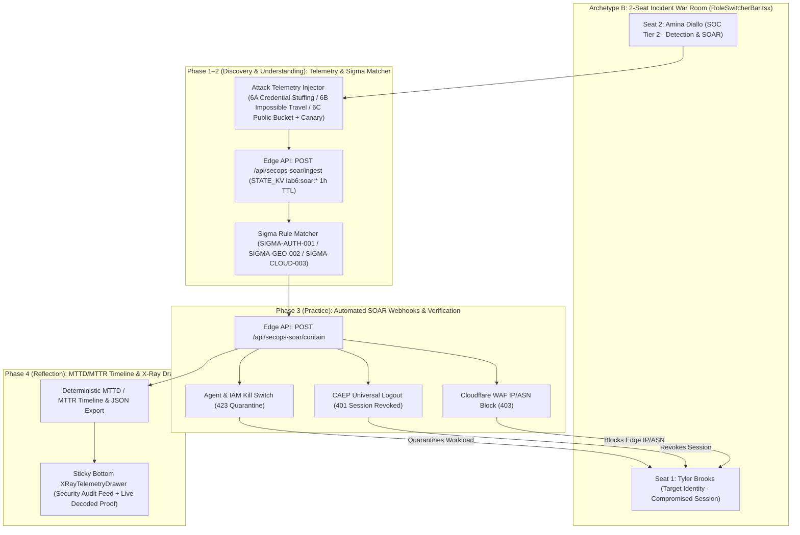

# Lab 6 Architecture: Live SecOps Detection & Automated SOAR (`/secops-soar`)

> **Zoom Level:** 2.5 (Lab Assembly + Infrastructure Mapping)  
> **Parent Overview:** [`0trust.dev/docs/ARCHITECTURE.md`](https://github.com/c2pig/0trust.dev/blob/main/docs/ARCHITECTURE.md)  
> **Experience Archetype:** Archetype B — 2-Seat Incident War Room (`Target Identity · Compromised Session` ↔ `SOC Tier 2 · Detection & SOAR`)  
> **Architecture SVG:** [`docs/diagrams/secops_soar_architecture.svg`](diagrams/secops_soar_architecture.svg)

---

## 1. End-to-End 2-Seat SecOps & SOAR Architecture

---

## 2. Distributed Repo & Infrastructure Ownership

| Lab Phase & Seat | Plain-English Purpose | Owning Application Repo | Provisioning Infrastructure |
| :--- | :--- | :--- | :--- |
| **Phase 1–2 (Discovery & Understanding · Seat 2 SOC)**: Telemetry & Sigma Matcher | Inject Credential Stuffing (`6A`), Impossible Travel (`6B`), or Public Bucket + Canary (`6C`) and match Sigma rules | [`0trust-lab-secops-soar`](https://github.com/c2pig/0trust-lab-secops-soar) (`functions/api/secops-soar/ingest.ts`, `src/engine/secopsSoarEngine.ts`) | `managed-infrastructure/modules/cloudflare-pages-lab` (`enable_custom_domain = false`, behind `0trust-lab-router` at `https://lab.0trust.dev/secops-soar`) |
| **Phase 3 (Practice · Seat 2 SOC ↔ Seat 1 Target)**: SOAR Containment & Verification | Execute `WAF_BLOCK_ASN`, `CAEP_UNIVERSAL_LOGOUT`, or `AGENT_KILL_SWITCH` and verify target seat revocation (`401`/`403`/`423`) | [`0trust-lab-secops-soar`](https://github.com/c2pig/0trust-lab-secops-soar) (`functions/api/secops-soar/contain.ts`, `src/pages/SecopsSoarPage.tsx`) | `STATE_KV` (`lab6:soar:<sessionId>`, `1h TTL`) |
| **Phase 4 (Reflection)**: MTTD/MTTR Timeline & Sticky X-Ray Drawer | Compare Manual vs. Auto-Remediate MTTR, export post-incident JSON, and inspect W3C `traceparent` + Sigma/CAEP proofs | [`0trust-lab-secops-soar`](https://github.com/c2pig/0trust-lab-secops-soar) (`src/components/XRayTelemetryDrawer.tsx`) | `$0.00` Guided Sandbox + `_middleware.ts` OTLP Trace Context |

---

## 3. Security & Containment Invariants Enforced

1. **Strict Enum & Payload Validation**:
   - `POST /api/secops-soar/ingest` validates `scenario` against `Set(['CREDENTIAL_STUFFING', 'IMPOSSIBLE_TRAVEL', 'PUBLIC_BUCKET_CANARY'])` and enforces `MAX_BODY_BYTES = 65536`.
   - `POST /api/secops-soar/contain` validates `action` against `Set(['WAF_BLOCK_ASN', 'CAEP_UNIVERSAL_LOGOUT', 'AGENT_KILL_SWITCH'])`.
2. **Session Isolation (`1h TTL`)**:
   - `STATE_KV` keys are scoped to `lab6:soar:<sanitizeSessionId>` with `expirationTtl: 3600` and `Cache-Control: no-store`.
3. **Immediate CAEP Session Revocation**:
   - Executing `CAEP_UNIVERSAL_LOGOUT` flips `compromised_user_revoked = true`, updates Tyler Brooks's seat badge to `Session Revoked`, and blocks simulated cloud app probes with `401 CAEP_SESSION_REVOKED`.
